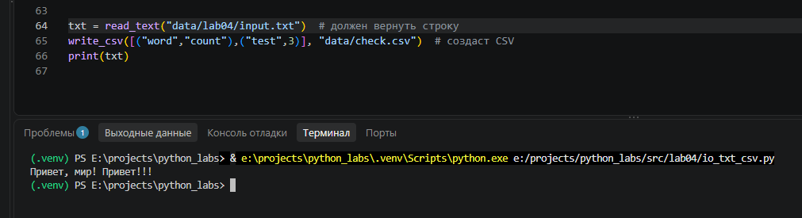
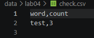
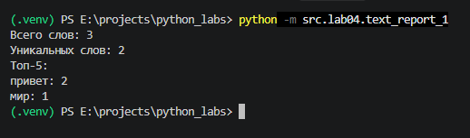
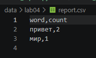
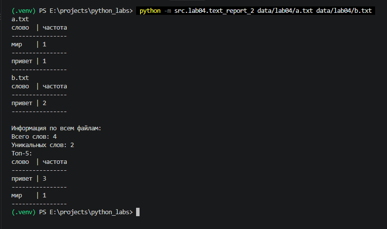
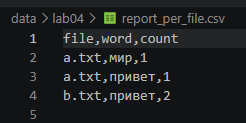
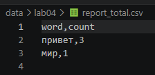

# ЛР4 - Файлы: TXT/CSV и отчёты по текстовой статистике
## Задание A

### `read_text`
```python
from pathlib import Path
def read_text(path: str | Path, encoding: str = "utf-8") -> str:

    """
    Читает текстовый файл целиком и возвращает его содержимое
    как одну строку.

    По умолчанию файл читается в кодировке UTF-8. Если нужен другой
    формат кодировки, можно передать его явно, например:
        read_text("data/input.txt", encoding="cp1251")

    Если файл не найден - функция не перехватывает ошибку,
    а даёт ей "всплыть" наружу как FileNotFoundError.
    Если кодировка не подходит к содержимому файла - аналогично
    всплывает UnicodeDecodeError.

    Если файл пустой - возвращается пустая строка "".
    """

    p = Path(path)
    # FileNotFoundError и UnicodeDecodeError пусть «всплывают» — это нормально
    return p.read_text(encoding=encoding)
```
1. Принимает путь к файлу и преобразует его в объект класса `Path` для работы.
2. Вызывает встроенный метод `.read_text()`, который открывает файл, декодирует его в указанной кодировке и полностью считывает в оперативную память в виде единой строки.
3. Ошибки отсутствия файла (`FileNotFoundError`) или несовпадения кодировки (`UnicodeDecodeError`) намеренно не перехватываются, позволяя им «всплывать» в вызывающий скрипт.
---

### `write_csv`
```python
import csv
from pathlib import Path
from typing import Iterable, Sequence

def ensure_parent_dir(path: str | Path) -> None:

    """Создать родительские директории для path, если их ещё нет."""

    Path(path).parent.mkdir(parents=True, exist_ok=True)


def write_csv(rows: Iterable[Sequence], path: str | Path,
              header: tuple[str, ...] | None = None) -> None:
    
    """
    Записать строки в CSV (разделитель ','). Перезаписывает файл.
    Если передан header — он записывается первой строкой.
    Все строки должны иметь одинаковую длину, иначе ValueError.
    """

    ensure_parent_dir(path)
    p = Path(path)
    rows = list(rows)

    length = {len(i) for i in rows}
    if header is not None:
        length.add(len(header))
    if len(length) > 1:
        raise ValueError("Все строки должны иметь одинаковую длину")

    with p.open("w", newline="", encoding="utf-8") as f:
        w = csv.writer(f)
        if header is not None:
            w.writerow(header)
        for r in rows:
            w.writerow(r)
```

1. `ensure_parent_dir` извлекает путь к содержащей папке целевого файла с помощью свойства `.parent`. Создает эту директорию методом `.mkdir()`. Флаг `parents=True` отвечает за рекурсивное создание вложенных папок, а `exist_ok=True` игнорирует ошибку, если папка уже существует.
2. `write_csv` принудительно конвертирует итерируемый объект строк в список `list(rows)` для фиксации данных в памяти.
3. Проверяет «прямоугольность» структуры: через генераторное множество собирает длины всех строк данных, а также длину заголовка `header` (если он передан). Если в множестве `lengths` оказывается больше одного значения, возбуждается исключение `ValueError`.
4. Вызывает функцию `ensure_parent_dir()` для гарантированного создания всех промежуточных папок перед сохранением.
5. Открывает файл через `p.open()` в режиме записи с параметром `newline=""`, предотвращающим появление пустых строк на Windows.
6. Инициализирует объект `csv.writer()`, записывает заголовок (при наличии), после чего в цикле `for` последовательно вносит в файл каждую строку данных.




---
## Задание B
```python
import sys
from src.lib.text import normalize, tokenize, count_freq, top_n
from src.lab04.io_txt_csv import read_text, write_csv

def main():
    try:
        raw_text = read_text("data/lab04/input.txt", encoding="utf-8")
    except FileNotFoundError:
        print("Ошибка: файл не найден")
        return

    clean = normalize(raw_text)
    tokens = tokenize(clean)
    unique = len(set(tokens))
    freq_dict = count_freq(tokens)

    all_rows = sorted(freq_dict.items(), key=lambda x: (-x[1], x[0]))
    top_5 = top_n(freq_dict)

    write_csv(all_rows, "data/lab04/report.csv", header = ("word", "count"))

    print(f"Всего слов: {len(tokens)}")
    print(f"Уникальных слов: {unique}")
    print("Топ-5:")
    for i in top_5:
        print(f"{i[0]}: {i[1]}")

if __name__ == "__main__":
    main()
```

1. Скрипт пытается прочесть входной файл `input.txt` через функцию `read_text()`. Процесс обернут в блок `try-except`: при отсутствии файла выводится сообщение `Ошибка: файл не найден` и выполнение функции завершается через `return`.
2. Успешно прочитанная строка передается в функцию `normalize()` для приведения к единому регистру, замены `ё` на `е` и очистки от лишних спецсимволов. Результат сразу передается в `tokenize()` для разбиения текста на список слов-токенов.
3. Функция `count_freq()` собирает токены в частотный словарь. Общее количество слов вычисляется как длина списка токенов (`len(tokens)`), а число уникальных — как размер словаря (`len(set(tokens))`).
4. Метод `freq_dict.items()` превращает словарь в список пар `(слово, частота)`. Функция `sorted()` упорядочивает их по ключу `lambda x: (-x[1], x[0])`.
5. Функция `top_n()` извлекает 5 самых частотных элементов для последующего вывода.
6. Отсортированный массив `all_rows` передается в функцию `write_csv()`, которая записывает его на диск по пути `report.csv` вместе с заголовком столбцов `("word", "count")`.
7. В терминал через f-строки выводятся итоговые числовые метрики и список топ-слов в цикле `for`.





---

## Задание со звёздочкой

```python
import sys
from pathlib import Path
from src.lib.text import normalize, tokenize, count_freq, top_n
from src.lab04.io_txt_csv import read_text, write_csv
            
def main():
    files = sys.argv[1:]
    if not files:
        print("Ошибка: не указаны входные файлы")
        return

    per_file_rows = []
    total_freq = {}
    total_tokens = 0
    total_unique_words = set()

    for path in files:
        try:
            raw_text = read_text(path, encoding="utf-8")
        except FileNotFoundError:
            print(f"Ошибка: файл не найден: {path}")
            return

        tokens = tokenize(normalize(raw_text))
        freq = count_freq(tokens)

        file_name = Path(path).name

        for word, cnt in freq.items():
            per_file_rows.append((file_name, word, cnt))
            total_freq[word] = total_freq.get(word, 0) + cnt

        total_tokens += len(tokens)
        total_unique_words.update(freq.keys())

        top_5 = top_n(freq)
        max_len = max([len(i[0]) for i in top_5])
        print(file_name)
        if max_len > 5:
            print("слово"+(max_len-4)*" "+"|"+" частота")
            print("-"*(10+max_len))
            for i in top_5:
                print(f"{i[0]:<{max_len}} | {i[1]}")
                print("-"*(10+max_len))
        else: 
            print("слово | частота")
            print("-"*15)
            for i in top_5:
                print(f"{i[0]:<{5}} | {i[1]}")
            print("-"*15)

    per_file_rows.sort(key=lambda r: (r[0], -r[2], r[1]))
    write_csv(per_file_rows, "data/lab04/report_per_file.csv", header=("file", "word", "count"))

    
    total_rows = sorted(total_freq.items(), key=lambda r: (-r[1], r[0]))
    write_csv(total_rows, "data/lab04/report_total.csv", header=("word", "count"))
    print()
    print("Информация по всем файлам:")
    print(f"Всего слов: {total_tokens}")
    print(f"Уникальных слов: {len(total_unique_words)}")
    print("Топ-5:")

    top_5 = top_n(total_freq)
    max_len = max([len(i[0]) for i in top_5])

    if max_len > 5:
        print("слово"+(max_len-4)*" "+"|"+" частота")
        print("-"*(10+max_len))
        for i in top_5:
            print(f"{i[0]:<{max_len}} | {i[1]}")
            print("-"*(10+max_len))
    else: 
        print("слово | частота")
        print("-"*15)
        for i in top_5:
            print(f"{i[0]:<{5}} | {i[1]}")
            print("-"*15)

if __name__ == "__main__":
    main()
```



---

## Политика обработки краевых ситуаций и ошибок

*   **Отсутствие входного файла (`FileNotFoundError`):** Если указанный файл по заданному пути не существует, программа прерывает выполнение, выводит в консоль понятное сообщение об ошибке вида `[Ошибка]: Файл не найден` и завершает работу с кодом.
*   **Сбой декодирования (`UnicodeDecodeError`):** Если кодировка файла не соответствует заданной (например, попытка прочесть файл `cp1251` как `utf-8`), программа безопасно завершается с уведомлением пользователя о необходимости явного указания параметра `--encoding`.
*   **Обработка пустого файла:** При передаче абсолютно пустого файла программа не падает. В консоли выводится статистика о нулевом количестве слов, а в результирующем CSV-файле сохраняется **строка заголовка (`word,count`)** без контента.
*   **Большие файлы:** Настоящее ТЗ подразумевает полное считывание файла в оперативную память как одной строки. При обработке терабайтных логов в реальных условиях рекомендуется модифицировать логику чтения на построчный или блочный стриминг.
*   **Валидация CSV-строк:** В модуле `io_txt_csv.py` встроена проверка структуры данных. Если переданный двумерный массив содержит строки разной длины, вызывается исключение `ValueError`.

---

## Способ запуска `text_report_1.py`

Запуск выполняется из корня репозитория (там, где лежит папка `src/`), с помощью флага `-m`:

```python
python -m src.lab04.text_report_1
```

## Способ запуска `text_report_2.py`

Запуск выполняется из корня репозитория (там, где лежит папка `src/`), с помощью флага `-m`:

```python
python -m src.lab04.text_report_2 data/lab04/a.txt data/lab04/b.txt
```
